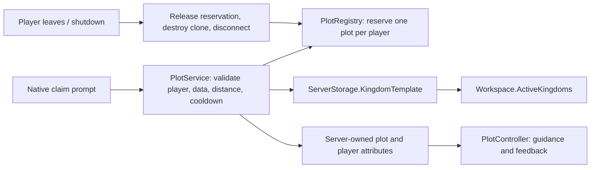

# Milestone 1.3: Claim your kingdom

Players arrive at the kingdom grounds, approach a gold banner, and hold the native
Roblox interaction to claim an available plot. Their starter settlement appears,
the entrance sign identifies its owner, and future character spawns move into its
courtyard. Leaving removes that settlement and makes the land available again.
Ownership is local to the current server session; reconnecting requires a new
claim. No gold, purchases, farm production, or saved plot locations are added.

## Architecture



Claims do not yield between reservation and commit. Roblox runs these Luau
callbacks cooperatively, so two claim callbacks cannot both acquire the same
reservation. Template failures destroy partial clones and restore availability.
Data readiness is checked with DataService.GetSnapshot; ownership never exposes
profiles or writes progression. Prompts have their own server-side distance and
alive-character checks, in addition to native Roblox behavior, with a per-player
request cooldown. There are no client-to-server remotes in this milestone.

The replicated attributes are presentation state, not an authority source:

- Plot model: `PlotId` (string), `OwnerUserId` (number or absent).
- Player: `KingdomPlotId` (string or absent), `PlotMessage` (string),
  `PlotMessageSerial` (monotonically increasing number).
- Runtime kingdom: `PlotId`, `OwnerUserId`.
- Plots folder: `AvailablePlotCount` (server-computed number). Clients use this
  count instead of inspecting streamed plot models, which may be unloaded when distant.

The server uses its private registry to decide ownership. The client only reads
these attributes to display claim guidance and availability.

## Studio asset contract

These assets are Studio-owned and outside all Rojo source-owned containers:

```text
Workspace
  KingdomMap (Model)
    ArrivalSpawn (SpawnLocation; enabled, neutral)
    ... permanent scenery
  Plots (Folder)
    Plot01 ... Plot04 (Model; unique nonempty string PlotId attribute)
      Origin (anchored BasePart; template pivot position AND rotation)
      ClaimMarker (anchored BasePart)
        ClaimPrompt (ProximityPrompt)
        ClaimLabelGui (BillboardGui)
          ClaimLabel (TextLabel)
      ... permanent land and boundary markers
  ActiveKingdoms (Folder; empty in Edit mode)
ServerStorage
  KingdomTemplate (archivable Model; anchored parts, no scripts)
    TemplateRoot (invisible PrimaryPart at local origin)
    SpawnPoint (invisible noncolliding SpawnLocation; enabled, neutral, no team change)
    EntranceBeam
      OwnerLabelGui (BillboardGui)
        OwnerLabel (TextLabel)
    ... starter visuals
```

PlotService explicitly assigns every player's RespawnLocation: ArrivalSpawn on
join/release, their clone's SpawnPoint on claim. Native Roblox respawning then
places each player correctly without a CharacterAdded teleport race. The kingdom
spawns are neutral; explicit assignments keep players at their own spawn without
adding teams. Any future system that changes RespawnLocation must coordinate with
PlotService instead of clearing or overriding those assignments.
This follows Roblox's documented [RespawnLocation contract](https://create.roblox.com/docs/reference/engine/classes/Player#RespawnLocation).
Changing plot rotations automatically rotates the whole template and spawn marker.

The initial grounds are centered at `(1400, 40, 0)` to preserve the pre-existing
castle, buildings, foliage, terrain, and original spawn. The four plots face the
shared plaza. The starter includes timber entrance posts, banners, an open
pavilion, benches, courtyard paths, and an outside farm footprint. That footprint
has no earnings or interactions yet.

`tools/BuildPlotScene.luau` is the approved one-time Studio Edit command used to
construct these assets. It is **not mapped by Rojo**. Run its contents only in a
fresh Studio scene without these names; it refuses to replace existing assets.
The script is retained as a reproducible asset recipe. Save the Studio place to
preserve subsequent manual art changes; a Rojo build exports code only.

No `default.project.json` changes were needed. Missing assets produce a clear
PlotService warning instead of an infinite wait in a fresh code-only place.
Malformed assets halt bootstrap with a contract assertion.

## Verification

Keep `DATA.STUDIO_MODE = "Mock"`. For the opt-in suite, enable
`PLOTS.RUN_TESTS_IN_STUDIO` on disk, sync, and Play before claiming manually.
The suite temporarily moves and respawns the first player, then restores their
position, leaving all plots unclaimed. Its intentional broken-template case logs a rollback warning.
Expected final line:

```text
[KingdomTycoon][PlotServiceTests] All plot-system checks passed (validation, throttle, rollback, clone, release, reclaim)
```

Disable the test switch after verification. Normal Play should print
`[KingdomTycoon][PlotService] Ready (4 plots)`. Approach a gold banner and hold E
(or use the native touch/gamepad prompt). Expect one starter kingdom and an owner
label, plus `Claimed Plot01 for <userId>` for that plot. Reset the character and
confirm arrival in the courtyard. Stop should print a release and the existing
DataService final-save confirmation. A fresh Play begins with all land unclaimed.

For the multiplayer acceptance check, use Studio's two-client local-server mode:

1. Both players approach the same banner and attempt a claim; exactly one wins.
2. Both see the same ownership sign and kingdom. The other player can claim a
   different plot, and neither player can acquire a second plot.
3. Reset the owner; they respawn in their own courtyard.
4. Close one client. Its kingdom disappears for the remaining client and the
   vacated plot can be claimed.

Full-server feedback follows the replicated plot attributes. With four clients,
claim all plots and join a fifth test client to inspect the waiting message.
Set the published server capacity deliberately before release; no capacity or
publishing settings are changed by this milestone.

## Performance and boundaries

No per-frame loops, NPCs, simulated production props, or physics-driven visuals.
Native RespawnLocation assignment avoids character-wait tasks and per-player
character connections entirely.
The template uses approximately fifty descendants; only claimed plots receive
clones. Connections and request history are cleaned on departure and shutdown.
The separate demonstration grounds prioritize isolation from existing art; their
terrain integration and a route to the original castle remain presentation work.

## Review and commit boundaries

Verification completed on 2026-10-21 in the approved Kingdom Tycoon place using
Mock data. Two native prompt claims competed for one plot and produced one owner;
both clients observed matching signs and availability. Exclusive ownership,
independent second-player claiming, actual courtyard respawn, owner disconnect
cleanup, late-join plaza spawn, and reclaim by a fresh connection passed. Native
StudioTestService ended the temporary sessions and the main place returned to
Edit mode. The four-plots-full/fifth-client message was not exercised with five
real clients. The developer will handle future Studio interactions and hands-on
checks unless computer use is explicitly requested.

The registry was committed by the developer as `27e17bb` (`feat: add exclusive
plot ownership registry`). Remaining changes are uncommitted; group them below
without adding the already-committed registry again.

Keep milestone 1.3 as several coherent commits, without mixing in later milestones:

1. `feat: add server-authoritative plot ownership` — PlotRegistry, PlotService
   (including native respawn ownership), runtime configuration, and server service registration.
2. `feat: add starter kingdom scene assets` — the one-time Studio builder and
   asset contract. Studio place exports stay ignored, outside Git history.
3. `feat: add plot claim guidance` — PlotController and client registration.
4. `test: verify plot lifecycle and respawning` — integration tests, their opt-in
   configuration/bootstrap hook, and verified status updates in project docs.

Shared configuration and bootstrap changes need their relevant hunks assigned to
the matching commit. Each commit should pass its applicable checks before the
next is recorded. No commits or pushes are made without the developer's request.
